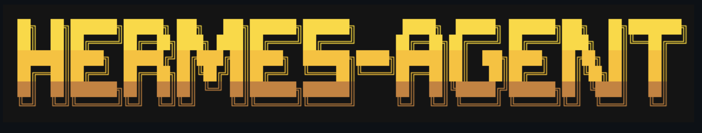
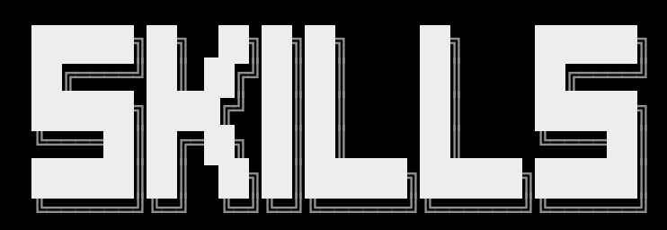

# Optional Acrazie Retro-Tech Vocabulary

Read only when the user explicitly requests this palette or retro-tech language.
These references inform an original design; they are not a default style, fixed
layout or permission to trace/recolor a supplied mark. No package logo is required
or generated by this skill.

## Supplied taste references




Extract principles, not silhouettes: modular heavy capitals, controlled cuts,
orthogonal geometry and subordinate southeast echoes can fit an approved brief.
For banners, contextual typography or restrained background structure may be useful.
Do not impose echo counts, grid pitch, telemetry, line lengths or two-line lettering.
Legibility and the approved message remain primary.

## Palette when requested

Preserve these source values only for a request using this palette:

```css
--pumpkin-spice: #ff6d00;
--harvest-orange: #ff7900;
--princeton-orange: #ff8500;
--deep-saffron: #ff9100;
--amber-glow: #ff9e00;
--dark-amethyst: #240046;
--indigo-ink: #3c096c;
--indigo-velvet: #5a189a;
--royal-violet: #7b2cbf;
--lavender-purple: #9d4edd;
```

An explicitly requested vertical sunset treatment may use this warm-to-violet order;
otherwise composition and gradient direction follow the approved brief. Background
and text colors depend on actual contrast and integration, not a preset dark theme.
Validate at the real output sizes, without claiming rendered proof from a text draft.
